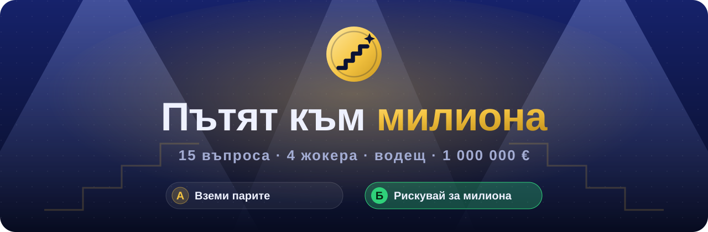
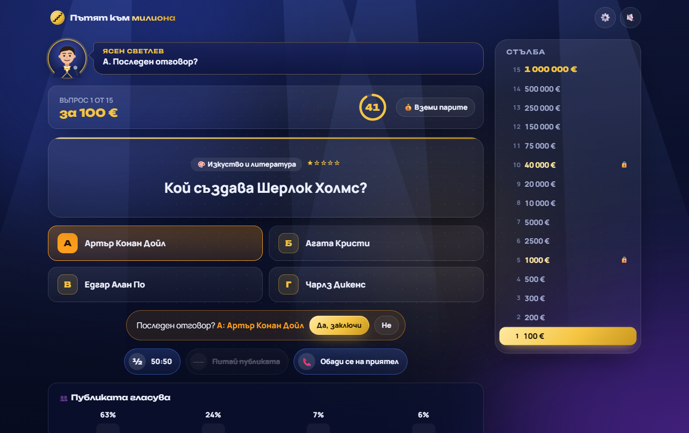
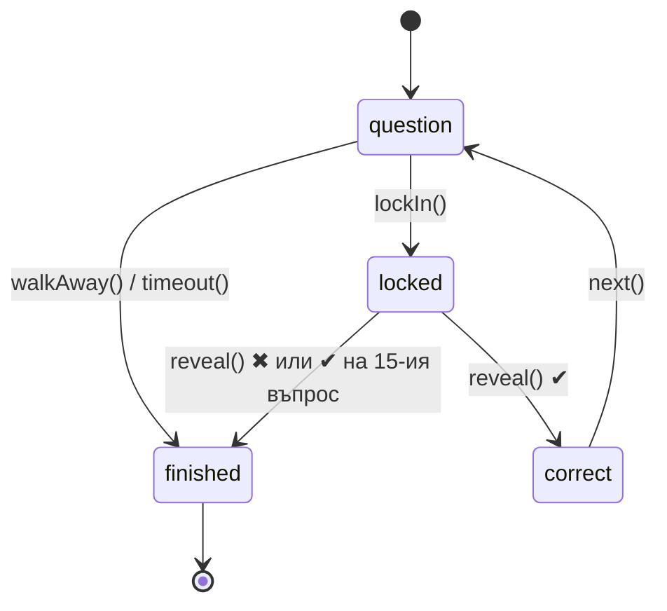

<p align="center">
  
</p>

<p align="center">
  <a href="https://krumqnkata.github.io/become-millionaire/"><b>🎮 Играй сега</b></a> ·
  <a href="#-как-се-играе">Как се играе</a> ·
  <a href="#-добави-въпрос">Добави въпрос</a> ·
  <a href="#-локално-стартиране">Разработка</a> ·
  <a href="#english">English</a>
</p>

<p align="center">
  <a href="https://github.com/Krumqnkata/become-millionaire/actions/workflows/deploy.yml"></a>
  
  
  
  
  <a href="LICENSE"></a>
</p>

**„Пътят към милиона“** е телевизионно куиз шоу в браузъра. Сядаш на стола срещу водещия Ясен Светлев: той те представя, чете въпросите на глас и пита „Последен отговор?“. Светлините угасват, музиката затихва, сърцето бие… и чак тогава разбираш дали си познал.

Няма регистрация, реклами или сървър. Всичко работи в браузъра, а въпросите са обикновени JSON файлове.

<p align="center">
  
</p>

## ✨ Какво има

|     |                     |                                                                                                                                                                                                                                                                                                              |
| --- | ------------------- | ------------------------------------------------------------------------------------------------------------------------------------------------------------------------------------------------------------------------------------------------------------------------------------------------------------ |
| 🎙️  | **Водещ**           | Оригинален герой с аватар и над 100 реплики. Говори на глас с най-добрия български глас на браузъра (в Microsoft Edge това е невронният „Borislav Natural“), а гласът може да се смени от настройките. Приятелките по телефона говорят с женски глас, ако има такъв. Без глас водещият „говори“ в балончета. |
| 🎵  | **Музика и звуци**  | Музиката е композирана в код с Web Audio API: фон, който става по-напрегнат с всяко ниво, сърдечен ритъм при заключен отговор, фанфари. Отгоре има истинска публика: аплодисменти, викове, барабанно тремоло преди големите отговори и звънящ телефон (записи с лиценз CC0).                                 |
| 💡  | **547 въпроса**     | 13 категории: история, география, наука, изкуство, спорт, кино и музика, България, обща култура, животни, технологии, митология, кухня и „Езикът ни“.                                                                                                                                                        |
| 🎚️  | **4 трудности**     | От „Лесно“ без таймер до „Експерт“ с 20 секунди, само 50:50 и без сигурни суми.                                                                                                                                                                                                                              |
| 🃏  | **4 жокера**        | 50:50, „Питай публиката“ с гласуване на живо, „Обади се на приятел“ с избор кого да потърсиш и 30 секунди разговор, „Смени въпроса“.                                                                                                                                                                         |
| 💡  | **Студио**          | Прожектори, които се движат по-бързо с наближаването на милиона, затъмняване при заключен отговор, зелена или червена светлина при отговора, конфети.                                                                                                                                                        |
| 💰  | **Вземи парите**    | Спри когато искаш. После водещият те пита какво щеше да отговориш и ти показва дали щеше да познаеш.                                                                                                                                                                                                         |
| 🏆  | **Зала на славата** | Топ 10 и статистика, пазят се локално в браузъра.                                                                                                                                                                                                                                                            |
| 📱  | **Навсякъде**       | Работи на телефон, с клавиатура и с екранен четец, и спазва `prefers-reduced-motion`.                                                                                                                                                                                                                        |

## 🎮 Как се играе

Отговаряш на **15 въпроса**, всеки по-труден и по-скъп от предишния. Можеш да спреш по всяко време и да вземеш спечеленото. При грешен отговор (или изтекло време) се връщаш до последната **сигурна сума** 🔒.

<details>
<summary><b>💶 Стълбата на наградите</b></summary>

| Ниво | Награда        | Ниво | Награда         | Ниво | Награда         |
| ---: | -------------- | ---: | --------------- | ---: | --------------- |
|    1 | 100 €          |    6 | 2 500 €         |   11 | 75 000 €        |
|    2 | 200 €          |    7 | 5 000 €         |   12 | 150 000 €       |
|    3 | 300 €          |    8 | 10 000 €        |   13 | 250 000 €       |
|    4 | 500 €          |    9 | 20 000 €        |   14 | 500 000 €       |
|    5 | **1 000 € 🔒** |   10 | **40 000 € 🔒** |   15 | **1 000 000 €** |

</details>

### 🎚️ Трудности

| Режим        | Таймер     | Жокери     | Сигурни суми | Въпроси             |
| ------------ | ---------- | ---------- | ------------ | ------------------- |
| **Лесно**    | без таймер | ½ 👥 📞 🔄 | нива 5 и 10  | по-леки (★ до ★★★★) |
| **Нормално** | 45 s       | ½ 👥 📞    | нива 5 и 10  | от ★ до ★★★★★       |
| **Трудно**   | 30 s       | ½ 👥 📞    | само ниво 10 | от ★★ до ★★★★★      |
| **Експерт**  | 20 s       | ½          | няма         | от ★★★ до ★★★★★     |

Таймерът тръгва, след като водещият прочете въпроса, и спира, докато използваш жокер.

### 🃏 Жокери

| Жокер                      | Какво прави                                                                                     |
| -------------------------- | ----------------------------------------------------------------------------------------------- |
| **½ 50:50**                | Премахва два грешни отговора.                                                                   |
| **👥 Питай публиката**     | Залата гласува. При лесни въпроси почти винаги е права, при трудни понякога се подвежда.        |
| **📞 Обади се на приятел** | Избираш на кого да звъннеш. Всеки приятел има любими теми и там отговаря по-уверено и по-точно. |
| **🔄 Смени въпроса**       | Нов въпрос със същата трудност (само в „Лесно“).                                                |

### ⌨️ Клавиши

| Клавиш              | Действие                                          |
| ------------------- | ------------------------------------------------- |
| `1`–`4` или `A`–`D` | Избор на отговор. Повторно натискане го заключва. |
| `Enter`             | Потвърди или продължи към следващия въпрос.       |
| `Space`             | Пропусни четенето на водещия.                     |
| `Esc`               | Откажи избора.                                    |
| `W`                 | Вземи парите.                                     |
| `L`                 | Покажи стълбата (на телефон).                     |
| `M`                 | Звук вкл./изкл.                                   |

## 💡 Добави въпрос

Въпросите са в [`public/questions/`](public/questions), по един JSON файл за всяка категория:

```json
{
  "id": "geo-047",
  "difficulty": 3,
  "question": "Коя е най-дългата река в Европа?",
  "answers": ["Дунав", "Рейн", "Волга", "Днепър"],
  "correct": 2,
  "explanation": "Волга е дълга около 3530 км и се влива в Каспийско море."
}
```

| Поле          | Описание                                                      |
| ------------- | ------------------------------------------------------------- |
| `id`          | Уникален, в kebab-case: префиксът на категорията плюс номер.  |
| `difficulty`  | От `1` (много лесен) до `5` (експертен).                      |
| `answers`     | Точно 4 различни отговора. Редът се разбърква при всяка игра. |
| `correct`     | Индексът (0–3) на верния отговор в `answers`.                 |
| `explanation` | По желание: интересен факт, който се показва след отговора.   |

След промяна пусни `npm run validate`. Скриптът проверява формата, уникалните id-та, повторените въпроси, смесената кирилица и латиница (например латинско „e“ в българска дума) и дали има достатъчно въпроси за всяка трудност. Същата проверка минава и в CI.

Нямаш време да пишеш JSON? [Предложи въпрос](https://github.com/Krumqnkata/become-millionaire/issues/new?template=new-question.yml) с формата в Issues. Повече подробности има в [CONTRIBUTING.md](CONTRIBUTING.md).

## 🔊 Звуци

Музиката и повечето ефекти се генерират в браузъра ([`src/audio/engine.ts`](src/audio/engine.ts)). Записите на публиката, барабаните и телефона са в [`public/audio/`](public/audio). Те са от [BigSoundBank](https://bigsoundbank.com) с лиценз CC0, а подробности има в [CREDITS.md](public/audio/CREDITS.md).

Всичко се описва в [`public/audio/manifest.json`](public/audio/manifest.json). В `samples` са записите, които се наслагват върху шоуто. В `replace` можеш да смениш генериран звук или фон със свой файл:

```json
{
  "samples": { "applause-small": "applause-small.mp3", "drumroll": "drumroll.mp3" },
  "replace": { "wrong": "my-wrong.mp3", "bed:tier3": "tension-loop.mp3" }
}
```

Звуци, които могат да се сменят: `intro`, `start`, `reveal`, `select`, `lock`, `correct`, `correctBig`, `wrong`, `safe`, `win`, `walk`, `tick`, `lifeline`, `fifty`, `keypad`, `ring`. Фонове (въртят се в цикъл): `bed:menu`, `bed:tier1`, `bed:tier2`, `bed:tier3`, `bed:suspense`, `bed:phone`. Използвай само звуци, които имаш право да публикуваш.

## 🎙️ Гласът на водещия

Водещият говори през Web Speech API. Сам избира най-добрия наличен български глас, като предпочита невронните („Natural“). От ⚙️ Настройки можеш да избереш друг глас и да го чуеш. Преди четене текстът се подготвя, за да звучи естествено: „1 000 000 €“ се чете като „милион евро“, „IX век“ като „девети век“, „343 m/s“ като „метра в секунда“ ([`src/audio/speech-text.ts`](src/audio/speech-text.ts)).

| Браузър                       | Глас                                            |
| ----------------------------- | ----------------------------------------------- |
| Microsoft Edge                | ✨ Borislav и Kalina (Natural), най-добрият     |
| Safari (Mac, iPhone)          | Daria                                           |
| Chrome на Android             | гласът на Google за български                   |
| Chrome или Firefox на Windows | Ivan, ако е инсталиран българският езиков пакет |

## 🛠 Локално стартиране

Трябва ти [Node.js](https://nodejs.org) 22.12 или по-нов.

```bash
git clone https://github.com/Krumqnkata/become-millionaire.git
cd become-millionaire
npm install
npm run dev
```

| Скрипт             | Какво прави                                        |
| ------------------ | -------------------------------------------------- |
| `npm run dev`      | Сървър за разработка с hot reload.                 |
| `npm run build`    | Проверка на типовете и production build в `dist/`. |
| `npm run preview`  | Пуска production build-а локално.                  |
| `npm test`         | Unit тестове с Vitest.                             |
| `npm run validate` | Проверка на всички въпроси.                        |
| `npm run lint`     | ESLint.                                            |
| `npm run format`   | Prettier.                                          |
| `npm run check`    | Lint, типове, въпроси и тестове наведнъж.          |

## 🧠 Как е направено

Няма framework, само TypeScript в strict режим и малък помощник `h()` за DOM. Логиката на играта е отделена от интерфейса, така че може да се тества без браузър.

```
src/
├── game/        чиста логика без DOM, покрита с тестове
│   ├── engine.ts      Game: state machine на една игра
│   ├── questions.ts   зареждане, валидиране и избор на въпроси
│   ├── lifelines.ts   50:50, публика, приятели
│   ├── ladder.ts      награди и сигурни суми
│   ├── modes.ts       четирите трудности
│   └── random.ts      seedable RNG (Mulberry32) за тестовете
├── show/script.ts     репликите на водещия
├── audio/
│   ├── engine.ts      синтезатор, музика и звуци (Web Audio API)
│   └── voice.ts       гласът на водещия (Speech Synthesis API)
├── storage/stats.ts   настройки, статистика, Зала на славата
├── ui/                екрани и компоненти
└── styles/            CSS: токени, компоненти, студио
public/questions/      въпросите (JSON)
scripts/               валидатор на въпросите
tests/                 Vitest
```

Една игра е малка state machine в [`src/game/engine.ts`](src/game/engine.ts):



Подбележки:

- **Избор на въпроси.** Взема се точната трудност от избраните категории. Ако такава няма, ограниченията се разхлабват стъпка по стъпка: ±1 трудност, после всички категории. Въпросите от последните игри се избягват.
- **Публиката и приятелите** не са просто „верен отговор + шум“. Точността им зависи от трудността, а приятелите знаят повече в любимите си теми. Тестовете проверяват статистиката с фиксиран seed.
- **Музиката** се планира с look-ahead scheduler, а не със `setInterval`, затова не се разминава с ритъма. Звукът минава през компресор и генериран reverb.
- **localStorage** се чете през проверки и `try/catch`. Повредени данни или блокирано хранилище не чупят играта.

## 🚀 Деплой

Всеки push в `main` пуска [`deploy.yml`](.github/workflows/deploy.yml): lint, проверка на въпросите, тестове, build и публикуване в GitHub Pages. Pull request-ите минават през същите проверки в [`ci.yml`](.github/workflows/ci.yml).

Base path-ът е `/become-millionaire/`. За друг хостинг го смени с `BASE_PATH=/ npm run build`.

## ⚖️ Бележка

„Пътят към милиона“ е оригинален проект в жанра на телевизионните куиз игри. Не е свързан с никое телевизионно предаване. Името, водещият, музиката, звуците и дизайнът са създадени специално за тази игра. Записите на публиката са с лиценз CC0 от BigSoundBank (Joseph Sardin).

## 📄 Лиценз

[MIT](LICENSE) © 2026 Krum

---

## English

**The Road to the Million** is a TV-style quiz show that runs in the browser, in Bulgarian. A virtual host introduces you, reads every question aloud through the browser's speech synthesis, asks “Final answer?” and keeps you waiting while the lights dim. Climb 15 questions to €1,000,000 with four lifelines (50:50, ask the audience, phone a friend, switch the question) across four difficulty modes. The bank has 547 questions in 13 categories.

Under the hood it is strict TypeScript and Vite with no UI framework. The game logic is a framework-free state machine with unit tests. The whole soundtrack is synthesized live with the Web Audio API. Questions are plain JSON, validated in CI. Run it with `npm install && npm run dev`.
